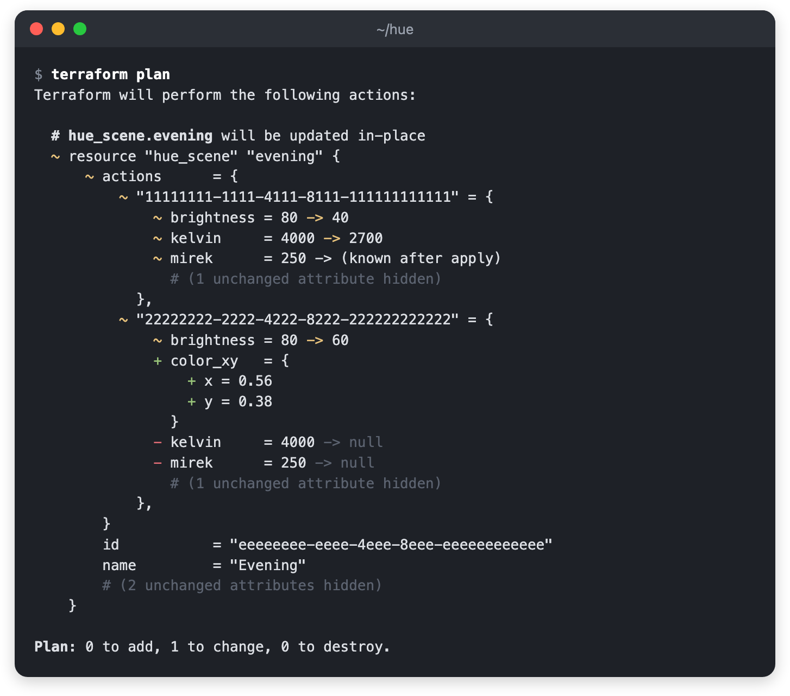
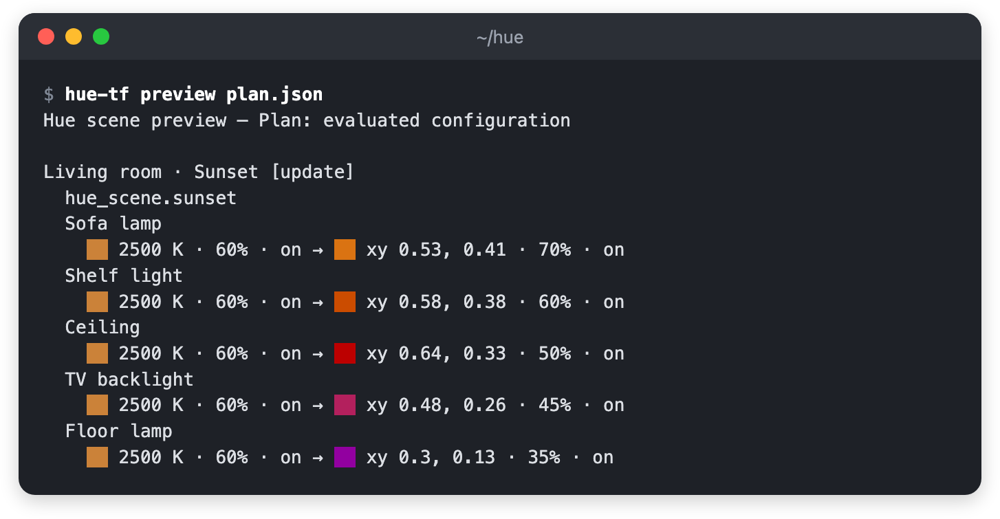
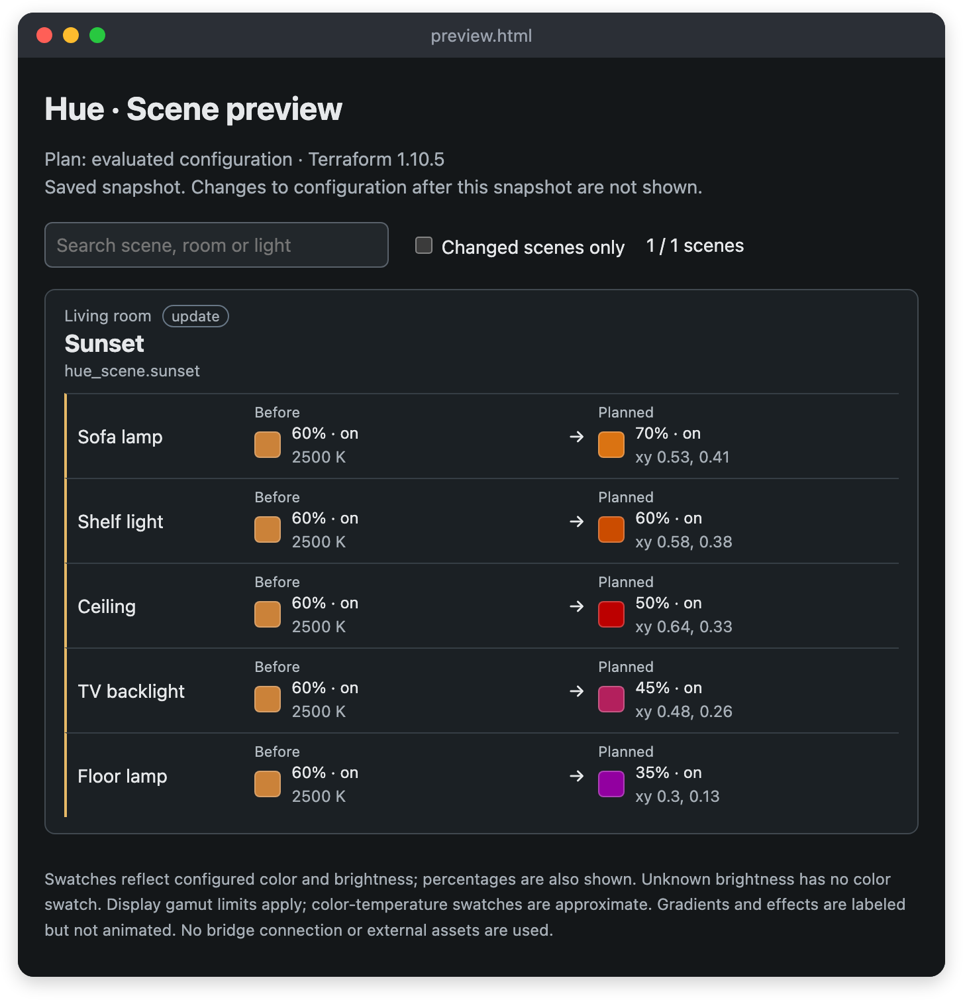

# terraform-provider-hue

A Terraform provider for Philips Hue API v2, with a companion CLI, `hue-tf`.
Manage rooms, zones, scenes, [smart scenes](docs/smart-scenes.md), switch
behaviors, and device names and icons.

**Add lights and devices using the Hue app. This provider manages resources that
are already registered on a Hue bridge.**



## Getting started

### 1. Install

`terraform init` installs the provider from the
[Terraform Registry](https://registry.terraform.io/providers/akr4/hue/latest).

Download `hue-tf` for your platform from the
[latest release](https://github.com/akr4/terraform-provider-hue/releases/latest).
If macOS says it cannot verify `hue-tf`, run
`xattr -d com.apple.quarantine hue-tf`. With Go 1.26 or later, you can run
`go install github.com/akr4/terraform-provider-hue/cmd/hue-tf@latest` instead.

### 2. Connect to the bridge

```sh
hue-tf init
# Press the bridge's link button, then run the three printed export commands.
```

The provider and CLI read `HUE_BRIDGE_HOST` (IP address or hostname),
`HUE_BRIDGE_ID` and `HUE_BRIDGE_APPLICATION_KEY`, and connect only to the
bridge whose certificate carries that ID. Protect the key like a password. If
the bridge's address changes later, `hue-tf discover` prints the current one
and the ID without creating a new key.

### 3. Try a zone and a scene

A zone groups lights without taking them out of their rooms, so trying one
leaves your setup as it was. Pick a light from `hue-tf ls light` and put its
UUID in `main.tf`:

```hcl
terraform {
  required_providers {
    hue = { source = "akr4/hue" }
  }
}

provider "hue" {}

data "hue_light" "desk" {
  id = "11111111-1111-4111-8111-111111111111" # A light UUID from `hue-tf ls light`.
}

resource "hue_zone" "trial" {
  name     = "Terraform trial"
  children = [data.hue_light.desk.id]
}

resource "hue_scene" "evening" {
  name  = "Evening"
  group = hue_zone.trial.id
  actions = {
    (data.hue_light.desk.id) = {
      on         = true
      brightness = 40
      kelvin     = 2700
    }
  }
}

output "scene_id" {
  value = hue_scene.evening.id
}
```

```sh
terraform init
terraform apply                                    # Creates the zone and the scene
hue-tf recall "$(terraform output -raw scene_id)"  # Turns the light on in warm white
terraform destroy                                  # Deletes the zone and the scene
```

Until you destroy them, the zone and the scene also show in the Hue app.

### 4. Manage what you made in the Hue app

Start from a `main.tf` that has only the `terraform` and `provider` blocks.
`hue-tf import-blocks` writes `import` blocks for every room, zone, scene, smart
scene and behavior instance that Terraform does not manage yet. Terraform then
writes their definitions:

```sh
hue-tf import-blocks --write
terraform plan -generate-config-out=generated.tf
terraform apply
```

Check that the plan only imports, then apply. From then on, Terraform manages
these resources, and removing one from the configuration deletes it from the
bridge. To import only some resources or import into modules, see
[Generate import blocks](docs/app-to-terraform.md). For switches, see
[switch management](docs/switch-management.md).

## Resources

Rooms contain **device** UUIDs; zones contain **light** UUIDs; scene actions are
keyed by light UUID. A device belongs to one room, so adding it to a room moves
it out of its current room. Destroying a resource deletes it from the bridge,
except `hue_device`, which only stops managing the device.

See [resources](docs/resources) and [data sources](docs/data-sources) for the
full reference.

## CLI

| Command | Description |
|---|---|
| `hue-tf discover` | Find bridges on the local network and print their addresses and IDs |
| `hue-tf ls TYPE [--json]` | List bridge resources such as `light`, `device`, `room`, `scene` and `switch` |
| `hue-tf show SCENE_UUID` | [Inspect a scene](docs/show.md) and what references it |
| `hue-tf raw /clip/v2/PATH` | Print the response of an API v2 GET request |
| `hue-tf import-blocks [--write]` | [Generate `import` blocks](docs/app-to-terraform.md) for unmanaged resources |
| `hue-tf preview` | [Render scene colors](docs/preview.md) from a Terraform plan |
| `hue-tf recall SCENE_UUID` | [Activate a scene](docs/runtime-commands.md) |
| `hue-tf identify UUID` | [Make a device signal](docs/runtime-commands.md) so you can find it |

`hue-tf preview` shows each light's color in a scene before and after a plan,
in the terminal or as an HTML page:





## Development

```sh
make build               # bin/terraform-provider-hue and bin/hue-tf
lefthook install         # Git hooks: gitleaks, gofmt, terraform fmt, go vet
TF_ACC=1 go test ./...   # Unit and acceptance tests against a fake bridge
make docs                # Regenerate the reference docs from the schema and templates
```

To use a local build of the provider, add a
[`dev_overrides`](https://developer.hashicorp.com/terraform/cli/config/config-file#development-overrides-for-provider-developers)
entry for `registry.terraform.io/akr4/hue` pointing to the absolute path of
`bin` in your Terraform CLI configuration, and skip `terraform init`.

Tests never connect to a real bridge, even when Hue environment variables are set.

## License

MIT. This is an independent project, not a Signify product.
